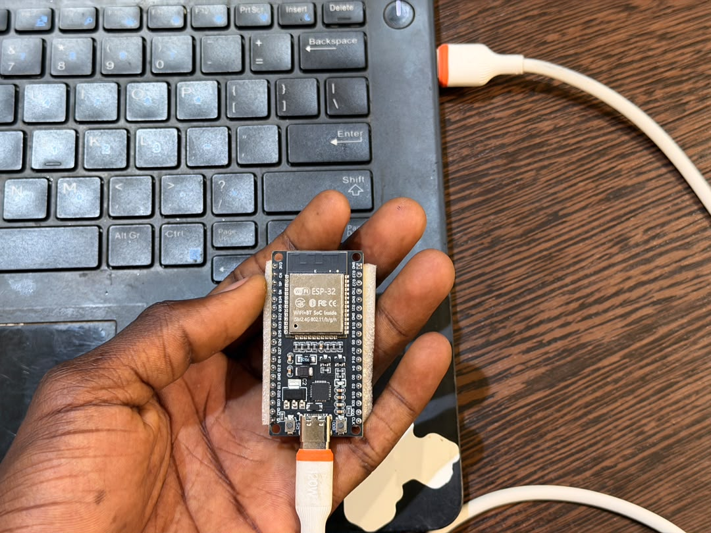
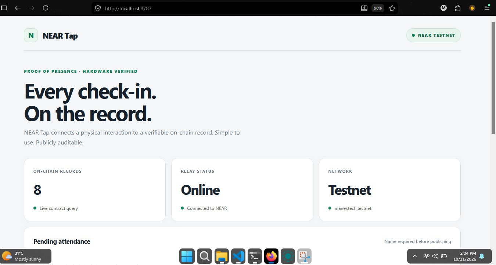
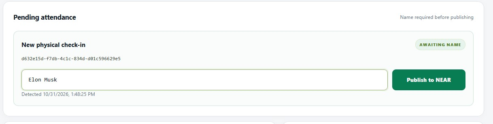
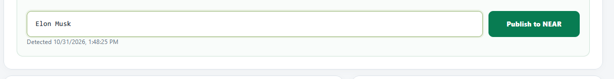
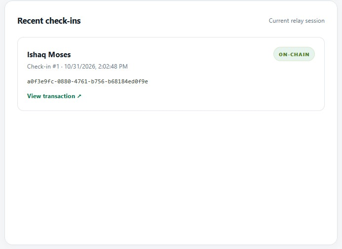
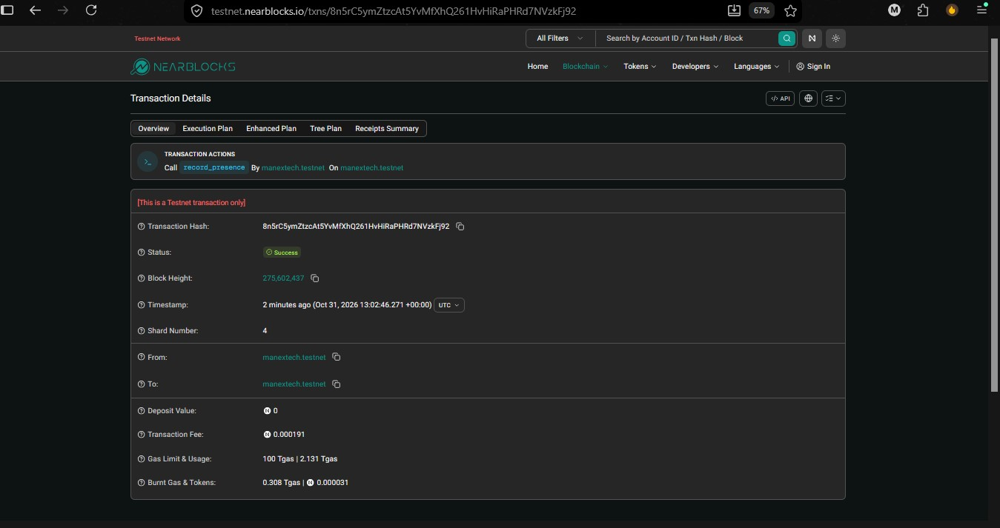

# NEAR Tap: Proof of Presence

NEAR Tap is an ESP32-powered attendance prototype that turns a physical check-in into a publicly verifiable record on **NEAR Protocol**.

At the check-in point, an ESP32 sends a device-authenticated event to a Node.js relay. An operator reviews the pending event, enters the participant's name, and explicitly publishes it to a NEAR smart contract. The contract stores the event ID and participant name on-chain, while the dashboard provides a transaction link for independent verification.

> **Prototype status:** NEAR Tap is a testnet demonstration, not a production attendance or identity-verification system.

## How attendance works

1. A participant presses the BOOT button on the ESP32 at the check-in point.
2. The ESP32 sends a check-in request to the relay using a shared device token.
3. The relay validates the token and creates a pending event. **No blockchain transaction is sent at this stage.**
4. An operator opens the dashboard, reviews the pending event, and enters the participant's name.
5. The operator selects **Publish to NEAR**.
6. The relay calls the NEAR smart contract with the event ID and participant name.
7. After NEAR confirms the transaction, the dashboard displays the published record and its testnet explorer link.

Participant names are stored in NEAR contract storage and can be retrieved with `get_presence_name(event_id)`. They are public blockchain data. Do not enter sensitive personal information, and obtain appropriate notice and consent before recording names.

## Features

- ESP32 BOOT-button check-in over Wi-Fi
- Shared-token authentication between the device and relay
- Pending check-in queue for operator review
- Dashboard workflow for entering a participant name and publishing attendance
- NEAR smart contract storage for event IDs and participant names
- On-chain record lookup by event ID
- Transaction hash and NEAR testnet explorer link after successful publication
- Responsive dashboard for monitoring and verification

## Screenshots

The screenshots below show the prototype's physical device, operator workflow, and on-chain verification evidence.

| ESP32 device | Dashboard |
|---|---|
|  |  |

| Pending check-in | Participant entry |
|---|---|
|  |  |

| On-chain success | NEAR Explorer |
|---|---|
|  |  |

Additional evidence: [record verification](assets/screenshots/verification.jpg) and [repository overview](assets/screenshots/repository.jpg).

## Business model and sustainability

NEAR Tap has a potential usage-based business model for event organizers, schools, conferences, and workplaces. A future hosted version could charge an organizer a small service fee per successfully published attendance record, or offer event-based packages with a fixed fee and an included attendance allowance.

The fee would be a platform/service charge for operating the check-in workflow, dashboard, and record-verification service. It should be disclosed to the organizer before an event begins. The organizer could decide whether to absorb the cost or include it in event registration pricing. NEAR network transaction costs are separate from the platform fee.

**This is a proposed monetization model, not a feature implemented in the current prototype.** The present testnet demo does not charge users or collect platform fees. Pricing, payment collection, refunds, and organizer billing would need to be designed and tested before launch.

## Architecture

```text
ESP32 device
    |
    | HTTPS/HTTP request + device token
    v
Node.js relay
    |
    | Pending event
    v
Operator dashboard
    |
    | Participant name + Publish
    v
NEAR smart contract
    |
    | On-chain record
    v
Dashboard verification
```

The relay uses a NEAR function-call access key to submit contract calls. The contract records the NEAR account that signed the transaction. In this setup, that is the relay account, not the ESP32 or the participant.

## Current implementation status

| Component | Status |
|---|---|
| ESP32 check-in firmware | Implemented |
| Device-token validation in relay | Implemented |
| Pending event queue | Implemented in relay memory |
| Participant name entry in dashboard | Implemented |
| Operator-triggered publish workflow | Implemented in source |
| Contract storage for participant names | Implemented in contract source |
| Record and name lookup | Implemented in contract source and relay |
| Dashboard transaction confirmation | Implemented in source |

**Testnet deployment verified:** The updated contract WASM is deployed to `manextech.testnet`. Read-only calls to `total_records()`, `get_presence(event_id)`, and `get_presence_name(event_id)` succeeded after the upgrade. The pre-upgrade record was preserved, and its name lookup correctly returned `null` because it predates participant-name storage.

A fresh named attendance transaction was also submitted successfully from the dashboard. The dashboard displayed the participant name and transaction link. Older records remain readable through `get_presence(event_id)`; they do not have participant names, so `get_presence_name(event_id)` returns no name for those records.

## Requirements

- Node.js 22 or newer
- An ESP32-WROOM-32 development board
- A Wi-Fi network accessible to both the ESP32 and the computer running the relay
- A NEAR testnet account
- A NEAR function-call access key scoped to the contract account and the `record_presence` method

## Try the prototype

This is a hardware-in-the-loop demo. To reproduce the complete flow, you need an ESP32 board, a computer on the same Wi-Fi network, and a configured NEAR testnet function-call key. The contract is already deployed at `manextech.testnet`.

### 1. Start the relay

Clone the repository, install dependencies, and enter the project directory:

```powershell
git clone https://github.com/manex-tech/near-tap.git
cd near-tap
npm install
```

Create the local `.env` file using the example in [Run the relay](#run-the-relay), then run:

```powershell
npm run check
npm start
```

**Expected result:** The terminal reports that the NEAR Tap relay is listening on port `8787`. Open `http://localhost:8787` in your browser to see the dashboard.

### 2. Connect the ESP32

Copy `firmware/secrets.example.h` to `firmware/secrets.h`. Add your Wi-Fi credentials, the same device token used in `.env`, and the computer's LAN IP address in `TAP_RELAY_URL`. Upload the firmware in PlatformIO using the `esp32dev` environment.

**Expected result:** The ESP32 connects to Wi-Fi and is ready to send a check-in when its BOOT button is pressed.

### 3. Create a pending check-in

With the relay running and the ESP32 connected to the same network, press the ESP32 BOOT button once.

**Expected result:** A new pending check-in appears on the dashboard. At this point, no blockchain transaction has been submitted.

### 4. Publish the attendance record

In the dashboard, enter a participant name for the pending check-in and select **Publish to NEAR**.

**Expected result:** The dashboard reports a successful on-chain publication and displays a transaction link. The participant name is an operator-entered label, not an identity check.

### 5. Verify it on NEAR

Open the transaction link from the dashboard. You can also use the dashboard's **Verify record** field with the event ID.

**Expected result:** NEAR Explorer shows the successful testnet transaction, and the dashboard retrieves the record and participant name from the deployed contract.

If a step fails, check that the relay is still running, the ESP32 and computer are on the same Wi-Fi network, the device token matches in both configurations, and the NEAR testnet account has sufficient balance and function-call-key allowance.

## Run the relay

Clone the repository and install dependencies from the project root:

```powershell
git clone https://github.com/manex-tech/near-tap.git
cd near-tap
npm install
```

Create a local `.env` file in the project root. Do not commit this file.

```env
PORT=8787
TAP_DEVICE_TOKEN=replace_with_a_long_random_device_token
NEAR_NETWORK=testnet
NEAR_ACCOUNT_ID=your_testnet_account.testnet
NEAR_CONTRACT_ID=your_contract_account.testnet
NEAR_PRIVATE_KEY=your_restricted_function_call_private_key
NEAR_RPC_URL=https://rpc.testnet.fastnear.com
```

Use a restricted function-call key that can call only `record_presence` on the intended contract. Keep the private key and device token secret. Never place them in source files committed to GitHub.

Check the relay source and start it:

```powershell
npm run check
npm start
```

Open [http://localhost:8787](http://localhost:8787) on the computer running the relay.

The dashboard and API are served by the Node.js process. The pending queue and recent activity are currently held in memory and are cleared when the relay restarts.

## Configure the ESP32

1. Copy `firmware/secrets.example.h` to `firmware/secrets.h`.
2. Set your Wi-Fi SSID and password.
3. Set `TAP_DEVICE_TOKEN` to the same random token configured as `TAP_DEVICE_TOKEN` in the relay's `.env` file.
4. Set `TAP_RELAY_URL` to the relay computer's LAN IP address and port, for example `http://192.168.1.100:8787/api/presence`.
5. Build and upload the firmware using the project's configured ESP32 toolchain.

Do not use `localhost` as the relay host in the ESP32 configuration. On the ESP32, `localhost` refers to the ESP32 itself, not the computer running the relay.

Keep `firmware/secrets.h` private. It contains Wi-Fi credentials and the device token and must not be committed.

## Smart contract interface

| Method | Purpose |
|---|---|
| `record_presence(event_id, participant_name)` | Records a unique event, participant name, predecessor account, and block timestamp. |
| `get_presence(event_id)` | Returns the attendance record for an event ID. |
| `get_presence_name(event_id)` | Returns the participant name associated with an event ID, or no value if none is stored. |
| `total_records()` | Returns the total number of records. |

The contract records the transaction predecessor account. Because the relay submits the transaction, the predecessor is the relay's NEAR account.

## Trust, security, and privacy limitations

NEAR Tap demonstrates a hardware-triggered attendance workflow. It does **not** independently establish a participant's identity or prove that a named person was physically present.

- **A button press is not identity verification.** It proves only that someone interacted with the device.
- **A typed name is an operator-entered label.** The contract does not verify that the name belongs to the person who pressed the button.
- **The relay signs the transaction.** The on-chain predecessor account identifies the relay account, not the ESP32 or participant.
- **The contract is publicly callable.** Restricting the relay's function-call key limits that key; it does not prevent other accounts from calling a public contract method.
- **The queue is temporary.** Pending events and recent activity are stored in relay memory and are lost when the relay restarts.
- **The publish route needs operator access control.** The current prototype does not provide production-grade operator authentication or event-level permissions. Do not expose it publicly without adding these controls.
- **Names are public and persistent.** Anyone may be able to read on-chain names, and blockchain data should not be treated as confidential or reliably erasable.

Before production use, add operator authentication, event-specific authorization and expiry, durable queue storage, stronger device authentication, abuse controls, and a privacy-conscious participant consent process. Consider NFC or another appropriate verification factor if the use case requires stronger evidence than a button press.

## Verify an attendance record

After a successful publication:

1. Copy the event ID from the dashboard.
2. Enter it in the dashboard's **Verify record** field.
3. The relay queries NEAR testnet for the record and its participant name.
4. Open the transaction link to inspect the transaction on the NEAR testnet explorer.

A record should be described as published only after the transaction has succeeded on NEAR. A pending event is not yet an on-chain attendance record.

## Repository review guides

This repository includes concise guides for human and AI-assisted review:

- [AGENTS.md](AGENTS.md): repository map, implementation workflow, review guidance, and checks for coding agents.
- [CLAUDE.md](CLAUDE.md): Claude Code entry point and project-specific review constraints.
- [Architecture](docs/ARCHITECTURE.md): component responsibilities, data flow, and trust boundaries.
- [Testing and verification](docs/TESTING.md): automated checks, manual acceptance tests, and demo evidence.
- [Security policy](SECURITY.md): implemented safeguards, known limitations, and production recommendations.
- [Roadmap](ROADMAP.md): implemented capabilities versus proposed improvements.

These files are intended to make the project easier to inspect and reproduce. They do not imply that planned features are implemented or that the prototype has undergone an independent security audit.

## Project

- Repository: [manex-tech/near-tap](https://github.com/manex-tech/near-tap)
- Network: NEAR testnet
- Purpose: IoT-powered, blockchain-based proof-of-presence prototype
